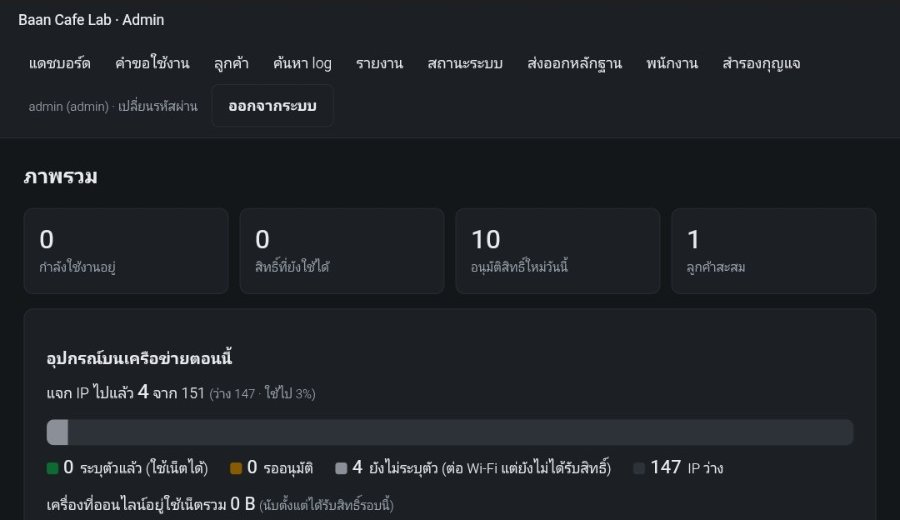
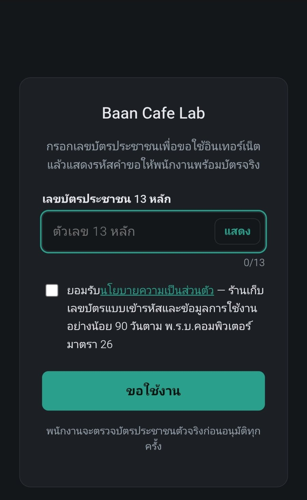
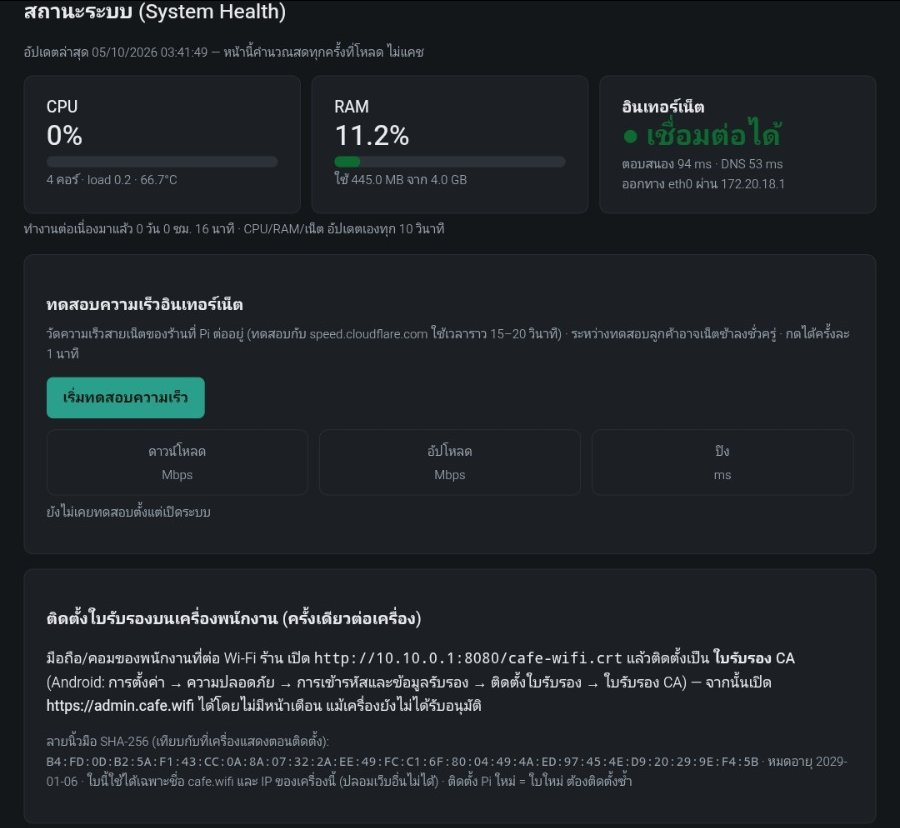

# คู่มือผู้ดูแลร้านและพนักงาน (Admin Guide)

> ใช้กับ **Cafe-WiFi OS 1.1.0 ขึ้นไป** · สำหรับเจ้าของร้าน (role `admin`) และพนักงานหน้าร้าน (role `staff`)

คู่มือนี้อธิบายการใช้งานหน้าเว็บแอดมินประจำวัน: อนุมัติลูกค้า ต่อเวลา ค้น log ส่งออกหลักฐานให้เจ้าหน้าที่ และดูแลสุขภาพเครื่อง
**ไม่ต้องพิมพ์คำสั่งใด ๆ** — ทุกอย่างทำผ่านเบราว์เซอร์ ส่วนการติดตั้งและงานช่าง ดู [`install-from-image.md`](install-from-image.md)

**สารบัญ**
1. [เข้าสู่ระบบและบทบาท](#1-เข้าสู่ระบบและบทบาท)
2. [แดชบอร์ด](#2-แดชบอร์ด)
3. [อนุมัติ / ปฏิเสธคำขอใช้งาน](#3-อนุมัติ--ปฏิเสธคำขอใช้งาน)
4. [ต่อเวลา / แก้จำนวนเครื่อง / ปิดสิทธิ์](#4-ต่อเวลา--แก้จำนวนเครื่อง--ปิดสิทธิ์)
5. [ลูกค้าและอุปกรณ์](#5-ลูกค้าและอุปกรณ์)
6. [จัดการพนักงาน](#6-จัดการพนักงาน-admin)
7. [ค้นหา log และตรวจความถูกต้อง](#7-ค้นหา-log-และตรวจความถูกต้อง)
8. [ส่งออกหลักฐานให้เจ้าหน้าที่](#8-ส่งออกหลักฐานให้เจ้าหน้าที่-admin)
9. [ดูเลขบัตรเต็ม (reveal)](#9-ดูเลขบัตรเต็ม-reveal-admin)
10. [สิทธิ์ของเจ้าของข้อมูล (DSR)](#10-สิทธิ์ของเจ้าของข้อมูล-dsr-admin)
11. [รายงาน](#11-รายงาน)
12. [สำรองกุญแจ (.cwkey)](#12-สำรองกุญแจ-cwkey-admin)
13. [สถานะระบบ](#13-สถานะระบบ)
14. [ลูกค้าเข้า Wi-Fi ไม่ได้ — บอกอะไรดี](#14-ลูกค้าเข้า-wi-fi-ไม่ได้--บอกอะไรดี)
15. [งานประจำวัน / ประจำเดือน](#15-งานประจำวัน--ประจำเดือน)
16. [FAQ](#16-faq)



---

## 1. เข้าสู่ระบบและบทบาท

**ที่อยู่หน้าเว็บ:** `https://admin.cafe.wifi` (ต้องต่อ Wi-Fi ของร้าน) — ครั้งแรกบนมือถือพนักงานให้ติดตั้งใบรับรองของร้านก่อน
ดู [หัวข้อ 13.3](#133-ติดตั้งใบรับรองของร้านบนเครื่องพนักงาน)

### บัญชีแรก (ตั้งตอนติดตั้ง)
บัญชี admin คนแรกสร้างผ่านหน้า `/setup` ด้วย Setup Token ตอนติดตั้ง (ช่างทำให้ ดู
[`install-from-image.md`](install-from-image.md)) พอสร้างแล้วหน้า `/setup` ปิดถาวร ใช้อีกไม่ได้

### เข้าสู่ระบบ
1. เปิดหน้า login กรอกชื่อผู้ใช้และรหัสผ่าน
2. ถ้ากรอกผิด ระบบแจ้งข้อความเดียวกันทุกกรณี (ไม่บอกว่าชื่อผู้ใช้มีจริงหรือไม่)
3. **กรอกผิดบ่อยจะถูกล็อกชั่วคราว 10 นาที** — ผิดเกิน 5 ครั้งต่อเครื่อง/IP หรือเกิน 10 ครั้งต่อชื่อผู้ใช้ (กันลูกค้าแกล้งเดารหัส)
4. login ค้างไว้ได้สูงสุด **8 ชั่วโมง** แล้วต้องเข้าใหม่ · กด "ออกจากระบบ" เมื่อเลิกงานทุกครั้ง (มีบันทึกเวลาเข้า/ออกใน audit log)

### เมื่อรหัสผ่านถูกเปลี่ยน
ถ้ามีการเปลี่ยนหรือรีเซ็ตรหัสของบัญชีคุณ **ทุกเครื่องที่ login ค้างไว้จะถูกออกจากระบบทันที**
และถ้า admin ปิดบัญชีหรือเปลี่ยน role ของคุณ session ปัจจุบันก็หลุดเช่นกัน

### บทบาท: admin กับ staff

| งาน | staff | admin |
|---|:-:|:-:|
| ดูแดชบอร์ด, รายงาน, สถานะระบบ | ได้ | ได้ |
| อนุมัติ/ปฏิเสธคำขอ (`/requests`) | ได้ | ได้ |
| ต่อเวลา / แก้จำนวนเครื่อง / ปิดสิทธิ์ | ได้ | ได้ |
| ดูรายชื่อลูกค้า (เลขบัตรแบบปิดบางหลัก) | ได้ | ได้ |
| ค้นหา log (`/logs`) | ได้ | ได้ |
| ดาวน์โหลด log เป็น CSV | ไม่ได้ | ได้ |
| ตรวจความถูกต้องของ log (hash chain) | ไม่ได้ | ได้ |
| ดูเลขบัตรเต็ม (reveal) | ไม่ได้ | ได้ |
| ระงับ/ยกเลิกระงับลูกค้า | ไม่ได้ | ได้ |
| ลบข้อมูลตามคำขอเจ้าของข้อมูล (DSR) | ไม่ได้ | ได้ |
| ส่งออกหลักฐาน (`/evidence`) | ไม่ได้ | ได้ |
| จัดการพนักงาน (`/staff`) | ไม่ได้ | ได้ |
| สำรองกุญแจ (`/keys`) | ไม่ได้ | ได้ |
| เห็นข้อมูล SSH สำหรับช่างในหน้าสถานะ | ไม่ได้ | ได้ |

พนักงานจะไม่เห็นเมนู **ส่งออกหลักฐาน / พนักงาน / สำรองกุญแจ** เลย และถ้าพิมพ์ URL ตรง ๆ ระบบแจ้ง "ไม่มีสิทธิ์" (403)
หลักการคือ **ให้คนทั่วไปในร้านทำงานหน้าเคาน์เตอร์ได้ แต่เรื่องข้อมูลส่วนบุคคลและกฎหมายอยู่ที่เจ้าของร้าน**

> ทุกคนควรมีบัญชีของตัวเอง **ห้ามใช้บัญชีร่วมกัน** — ไม่งั้น audit log บอกไม่ได้ว่าใครอนุมัติ/เปิดดูเลขบัตร

### นโยบายรหัสผ่าน
รหัสผ่านใหม่ต้อง **ยาวอย่างน้อย 12 ตัว** มีตัวพิมพ์เล็ก ตัวพิมพ์ใหญ่ และตัวเลขอย่างละ 1 ตัวขึ้นไป
(เปลี่ยนเองได้ที่ลิงก์ชื่อคุณมุมขวาบน → "เปลี่ยนรหัสผ่าน" ที่ `/account/password`)

---

## 2. แดชบอร์ด

หน้าแรก (`/`) สรุปสิ่งที่เกิดขึ้นตอนนี้:

- **ตัวเลขด้านบน** — กำลังใช้งานอยู่ · สิทธิ์ที่ยังใช้ได้ · อนุมัติสิทธิ์ใหม่วันนี้ · ลูกค้าสะสม
- **อุปกรณ์บนเครือข่ายตอนนี้** — แจก IP ไปกี่เครื่อง (ว่างเหลือเท่าไร) แบ่งเป็น
  - *ระบุตัวแล้ว* = อนุมัติแล้ว ใช้เน็ตได้
  - *รออนุมัติ* = ขอแล้ว รอพนักงาน (แสดงรหัสคำขอ)
  - *ยังไม่ระบุตัว* = ต่อ Wi-Fi แล้วแต่ยังไม่ได้รับสิทธิ์
  กดดูรายการเครื่องได้ (ชื่อเครื่อง/ระบบปฏิบัติการ, IP, ลูกค้าแบบปิดบางหลัก, ปริมาณที่ใช้)
- **สิทธิ์ที่อนุมัติล่าสุด** — ลูกค้า เครื่อง ปริมาณที่ใช้ เวลาเริ่ม/หมด สถานะ และผู้อนุมัติ พร้อมปุ่มต่อเวลา/ปิดสิทธิ์

เมนูด้านบนทุกหน้า: **แดชบอร์ด · คำขอใช้งาน · ลูกค้า · ค้นหา log · รายงาน · สถานะระบบ**
(admin เห็นเพิ่ม: ส่งออกหลักฐาน · พนักงาน · สำรองกุญแจ) — ตัวเลขสีแดงข้างคำว่า "คำขอใช้งาน" คือจำนวนคำขอที่รออนุมัติ

---

## 3. อนุมัติ / ปฏิเสธคำขอใช้งาน

หน้า **คำขอใช้งาน** (`/requests`) เป็นหน้าที่พนักงานใช้บ่อยที่สุด (รีเฟรชเองทุก 5 วินาทีเมื่อคุณไม่ได้พิมพ์อยู่)

### สิ่งที่ลูกค้าเห็นและทำ
ลูกค้าต่อ Wi-Fi → เด้งหน้า portal → กรอก **เลขบัตรประชาชน 13 หลัก** + ติ๊กยอมรับนโยบายความเป็นส่วนตัว → ได้ **รหัสคำขอ 4 ตัว**
แล้วหน้าจอบอกให้ "แสดงรหัสนี้ให้พนักงาน พร้อมบัตรประชาชนตัวจริง" หน้าจะเปลี่ยนเองเมื่อพนักงานอนุมัติ



คำขอที่ไม่มีใครอนุมัติ **หมดอายุใน 15 นาที** (ลูกค้าต้องขอใหม่)

### ขั้นตอนของพนักงาน (ทำทุกครั้ง)
1. เปิดหน้า **คำขอใช้งาน** → หาแถวที่มี **รหัสคำขอตรงกับที่ลูกค้าชี้ที่จอ**
2. ขอ **บัตรประชาชนตัวจริง** ตรวจว่าเป็นบัตรของคนนั้น
3. พิมพ์ **เลข 4 ตัวท้ายของบัตร** ลงในช่อง "4 ตัวท้ายจากบัตร"
   (ระบบเทียบกับที่ลูกค้ากรอก — เห็นเลขบัตรแค่แบบปิดบางหลัก พนักงานไม่เห็นเลขเต็ม)
4. เลือกแพ็กเกจ (ถ้าเป็นลูกค้าที่ยังไม่มีสิทธิ์ใช้งานอยู่):
   - **ชั่วโมง** 1 / 2 / 3 / 4 / 8 / 12 / 24 (ค่าเริ่มต้น 4)
   - **จำนวนเครื่อง** 1–5 (ค่าเริ่มต้น 2)
   - **โควตา** ไม่จำกัด / 500 MB / 1 GB / 2 GB / 5 GB
5. กด **อนุมัติ** — เครื่องลูกค้าใช้เน็ตได้ภายในไม่กี่วินาที

### เมื่อเลข 4 ตัวท้ายไม่ตรง
ระบบไม่อนุมัติและบันทึกเหตุการณ์ไว้ใน audit log (`request_mismatch`) ให้ตรวจบัตรอีกครั้ง
หรือให้ลูกค้าขอใหม่ — **อย่าอนุมัติถ้าบัตรไม่ใช่ของคนที่ยืนอยู่**

### สถานะพิเศษที่อาจเจอบนแถวคำขอ
| ป้าย | ความหมาย / ต้องทำอะไร |
|---|---|
| ลูกค้าใหม่ / ลูกค้าเก่า (มา N ครั้ง) | ข้อมูลประกอบเฉย ๆ |
| **มีสิทธิ์อยู่แล้ว** ถึง HH:MM · ใช้ N/M เครื่อง | ลูกค้ายังมีสิทธิ์เหลือ — เครื่องใหม่จะ **เข้าสิทธิ์เดิม** (เวลา/โควตาร่วมกัน ไม่ออกสิทธิ์ใหม่ซ้อน) |
| ใช้ครบแล้ว — เพิ่มจำนวนเครื่องก่อน | เครื่องเต็มตามที่ตั้งไว้ → แก้ "จำนวนเครื่อง" ในแถวนั้นก่อนแล้วค่อยกดอนุมัติ |
| **ลูกค้าถูกระงับ** | อนุมัติไม่ได้ (admin เป็นผู้ระงับ ดู [หัวข้อ 5](#5-ลูกค้าและอุปกรณ์)) |

### ปฏิเสธ
กด **ปฏิเสธ** พร้อมใส่เหตุผลสั้น ๆ (ไม่บังคับ) ลูกค้าจะเห็นข้อความ "คำขอไม่ได้รับอนุมัติ" พร้อมเหตุผล และขอใหม่ได้
**เมื่ออนุมัติหรือปฏิเสธแล้ว ระบบลบสำเนาเลขบัตรออกจากตัวคำขอทันที** (เก็บเฉพาะในตารางลูกค้า)
ด้านล่างของหน้ามีตาราง "ล่าสุด" 10 รายการที่ตัดสินแล้ว (ใครตัดสิน เมื่อไร)

---

## 4. ต่อเวลา / แก้จำนวนเครื่อง / ปิดสิทธิ์

ทุกคน (admin และ staff) ทำได้ ปุ่มอยู่ที่แดชบอร์ดและหน้าคำขอ ทุกครั้งมีบันทึกใน audit log

| งาน | ทำอย่างไร | หมายเหตุ |
|---|---|---|
| **ต่อเวลา** | เลือก +30 / +60 / +120 นาที | ต่อได้เฉพาะสิทธิ์ที่ **ยังไม่หมดอายุ** — เครื่องที่ออนไลน์อยู่ได้เวลาใหม่ภายในราว 5 วินาที ไม่ต้องขอใหม่ |
| **แก้จำนวนเครื่อง** | ใส่เลข 1–5 | ลดต่ำกว่าจำนวนเครื่องที่ผูกกับสิทธิ์แล้วไม่ได้ |
| **ปิดสิทธิ์** | กดปิดสิทธิ์ (revoke) | ใช้เมื่อออกผิด/ลูกค้าขอยกเลิก — เครื่องที่ออนไลน์หลุด **ภายในไม่กี่วินาที** · ปิดแล้ว **เปิดคืนไม่ได้** ให้ลูกค้าขอใหม่ |

ถ้าสิทธิ์ **หมดเวลาไปแล้ว** ต่อไม่ได้ — ให้ลูกค้าเปิดเว็บใดก็ได้แล้วขอใช้งานใหม่ (พนักงานอนุมัติใหม่ตามขั้นตอนหัวข้อ 3)

---

## 5. ลูกค้าและอุปกรณ์

หน้า **ลูกค้า** (`/customers`) แสดง 100 รายล่าสุด: เลขบัตรแบบปิดบางหลัก · สถานะ (ออนไลน์ / ปกติ / ถูกระงับ / ลบข้อมูลแล้ว) ·
เครื่องที่ใช้ล่าสุด (ชื่อเครื่อง + ระบบปฏิบัติการ) · ปริมาณที่ใช้รวม · มาครั้งแรก/ล่าสุด · จำนวนครั้ง

**ค้นหาลูกค้า:** พิมพ์เลขบัตร 13 หลัก (ต้องถูกต้องตามเลขตรวจสอบ) ระบบค้นด้วยค่า hash ไม่ได้เก็บเลขบัตรแบบอ่านได้ในตารางค้นหา

### เมนู "จัดการ" (admin เท่านั้น)
- **เปิดเผยเลขเต็ม** → ดู [หัวข้อ 9](#9-ดูเลขบัตรเต็ม-reveal-admin)
- **ระงับการใช้งาน / ยกเลิกระงับ** — ระงับแล้ว ตัดเน็ตทุกเครื่องของลูกค้ารายนั้น (หลุดภายใน 5 นาที) และห้ามขอใช้งานใหม่
  จนกว่าจะยกเลิก · ใช้กับลูกค้าที่ก่อปัญหา
- **ลบข้อมูลตามคำขอ (DSR)** → ดู [หัวข้อ 10](#10-สิทธิ์ของเจ้าของข้อมูล-dsr-admin)

---

## 6. จัดการพนักงาน (admin)

หน้า **พนักงาน** (`/staff`)

### สร้างบัญชีพนักงานใหม่
1. กรอก **ชื่อผู้ใช้** (3–64 ตัว ใช้ได้เฉพาะ a-z, A-Z, 0-9, `.`, `_`) + ชื่อที่แสดง + เลือก role (`staff` หรือ `admin`)
2. กดสร้าง → ระบบแสดง **รหัสผ่านชั่วคราว** รูปแบบ `xxxx-xxxx-xxxx` **ครั้งเดียวเท่านั้น**
   (ปิดหน้านี้แล้วดูซ้ำไม่ได้ — ถ้าลืมจดต้องรีเซ็ตใหม่)
3. **ส่งรหัสให้พนักงานตัวต่อตัว** อย่าส่งในแชตกลุ่ม

### วงจรรหัสชั่วคราว (บังคับเปลี่ยนรหัส)
```
admin สร้างบัญชี / กดรีเซ็ต  →  ระบบสุ่มรหัสชั่วคราว (แสดงครั้งเดียว)
→ พนักงาน login ด้วยรหัสนั้น  →  ถูกพาไปหน้า "เปลี่ยนรหัสผ่าน" ทันที (เข้าหน้าอื่นไม่ได้)
→ ตั้งรหัสของตัวเอง (ตามนโยบาย 12 ตัวขึ้นไป)  →  ใช้งานปกติ
```
ผลคือ admin **ไม่มีทางรู้รหัสจริงของพนักงาน** · เมื่อรีเซ็ตรหัส ทุกเครื่องที่พนักงานคนนั้น login ค้างไว้ถูกออกจากระบบทันที

### งานอื่นในหน้านี้
| งาน | ข้อควรรู้ |
|---|---|
| ปิด/เปิดบัญชี | ปิดบัญชีพนักงานที่ลาออกทันที (ไม่ลบประวัติ — audit log ยังชี้กลับมาที่บัญชีนั้นได้) |
| เปลี่ยน role (admin ↔ staff) | **เปลี่ยน role ของตัวเองไม่ได้** ต้องให้ admin คนอื่นทำ |
| รีเซ็ตรหัสผ่าน | **รีเซ็ตของตัวเองไม่ได้** ใช้เมนู "เปลี่ยนรหัสผ่าน" แทน |
| ต้องเหลือ admin ที่ใช้งานได้ **อย่างน้อย 1 คน** เสมอ | ระบบไม่ยอมให้ปิด/ลดสิทธิ์ admin คนสุดท้าย |

แนะนำให้มี admin อย่างน้อย 2 คน (เจ้าของ + คนที่ไว้ใจ) กันกรณีคนใดคนหนึ่งลืมรหัส

---

## 7. ค้นหา log และตรวจความถูกต้อง

### 7.1 ค้นหา log (`/logs`) — staff และ admin
ระบบเก็บ 2 ชนิด: **การเชื่อมต่อ** (ใครต่อไปที่ IP/พอร์ตไหน ปริมาณเท่าไร) และ **DNS** (เครื่องไหนถามชื่อเว็บอะไร)
ตามที่ พ.ร.บ.คอมพิวเตอร์ มาตรา 26 กำหนด

วิธีใช้:
1. เลือกชนิด log และ **ช่วงเวลา**: 1 ชม.ล่าสุด / วันนี้ / เมื่อวาน / 7 วันล่าสุด / กำหนดเอง (**ค้นได้ครั้งละไม่เกิน 31 วัน**)
2. พิมพ์ในช่องค้นหา **ช่องเดียว** — ระบบเดาชนิดให้เอง:
   - เลขบัตร 13 หลัก · รหัสอ้างอิง `CAFE-xxxxx` · MAC · IP · **ช่วง IP (CIDR)** เช่น `192.168.50.0/24` · ชื่อเว็บ (มีจุด เช่น `example.com`) · ชื่อเครื่องลูกค้า/ชื่อเว็บ (ไม่มีจุด)
   - ช่วง IP (ทั้งในช่องค้นหาและช่องปลายทาง) กว้างสุดได้ IPv4 `/16` และ IPv6 `/48` — กว้างกว่านี้ระบบปฏิเสธ (กันค้นทั้งตาราง)
   - **ชื่อเว็บที่มีจุด = เว็บนี้และโดเมนย่อย** เช่น `facebook.com` เจอ `m.facebook.com` ด้วย แต่ไม่เจอ `notfacebook.com` (ต้องรัน migration 014; ถ้ายังไม่รัน ระบบถอยไปค้นแบบมีคำนี้อยู่ในชื่อ) · ชื่อไม่มีจุดค้นแบบ "มีคำนี้อยู่ในชื่อ" เหมือนเดิม
3. (ไม่บังคับ) ช่อง **ชื่อเว็บ / IP ปลายทาง** — ใช้คู่กับช่องค้นหาด้านบนแบบ **และ** (ต้องตรงทั้งคู่) เช่น ค้น MAC ของลูกค้า + `facebook.com`
   = "เครื่องนี้เคยเข้า Facebook ไหม" · ใส่ได้: IP, ช่วง IP แบบ CIDR (เช่น `157.240.0.0/16`) หรือชื่อเว็บ · ว่าง = ไม่กรอง
   ในแท็บ **การเชื่อมต่อ** กรองเพิ่มได้ด้วย **พอร์ตปลายทาง** (1–65535) และ **โปรโตคอล** (tcp / udp / icmp / other) — แท็บ DNS ไม่มีสองช่องนี้
4. ติ๊ก "เฉพาะที่ระบุตัวได้" เพื่อซ่อนแถวที่ยังไม่รู้ว่าเป็นของใคร
5. ใต้ช่องค้นหาจะบอกว่าระบบ **ค้นเป็น** อะไร (เช่น MAC, เลขบัตร, ชื่อเว็บ — ถ้ามีช่องปลายทางจะต่อท้ายว่า "+ ปลายทาง: …") — ถ้าไม่ตรงกับที่ตั้งใจให้แก้คำค้น
6. คลิกค่าในตาราง (MAC, IP, ชื่อเว็บ, เลขบัตรของลูกค้า ฯลฯ) เพื่อค้นต่อจากค่านั้น · ลิงก์ "สรุป" ข้าง MAC/ลูกค้าเปิดหน้าสรุป · แสดงทีละ 50 แถว
   (ตัว `_` และ `%` ในคำค้นถือเป็นตัวอักษรธรรมดา ไม่ใช่ตัวแทน)

#### ตัวเลือกแนะนำขณะพิมพ์

- พิมพ์อย่างน้อย 1 ตัว (ถ้าเป็นตัวเลขต้องพิมพ์อย่างน้อย 2 หลัก) ระบบจะแสดงรายการให้เลือก แบ่งเป็นกลุ่ม: **ลูกค้า** (เลขบัตร), **อุปกรณ์** (ชื่อเครื่อง), **เลขอ้างอิง** (`CAFE-`), **MAC**, **IP**
- เลือกด้วยเมาส์หรือแตะ หรือกด ↑ ↓ แล้ว Enter · กด Esc เพื่อปิดรายการ · เมื่อเลือกแล้วระบบค้นทันที
- เลือก **อุปกรณ์** → ค้นด้วย MAC ของเครื่องนั้น
- เลือก **ลูกค้า** → ค้นทุกเครื่องที่ใช้สิทธิ์ของลูกค้าคนนั้น
- **admin** จับคู่เลขบัตรได้ทุกหลัก และรายการแนะนำแสดง **เลขบัตรเต็ม** · ทุกครั้งที่ระบบแนะนำจากเลขบัตรจะบันทึกใน audit log (`suggest_natid`) และจำกัดไว้ที่ 120 ครั้งต่อ 10 นาที
- **staff** จับคู่เลขบัตรได้เฉพาะหลักที่ 1–5 และหลักสุดท้ายเท่านั้น และเห็นเฉพาะเลขแบบปิดบัง
- ยังไม่แนะนำชื่อเว็บ — ต้องพิมพ์ชื่อเว็บเองเหมือนเดิม

ข้อควรรู้:
- **ทุกการค้นถูกบันทึกใน audit log** (ใครค้นอะไร เมื่อไร) — ค้นเฉพาะเรื่องที่จำเป็น เลขบัตรที่ค้นบันทึกแบบปิดบางหลัก
- **เลขบัตรเต็ม (admin เท่านั้น):** ตารางผลค้นแสดงเลขเต็มรูปแบบ `d-dddd-ddddd-dd-d` ส่วน staff เห็นแบบปิดบัง · ทุกหน้าที่แสดงเลขเต็ม
  ระบบบันทึก audit `view_natid_log` 1 แถว (ชนิด log, หน้า, จำนวนราย — ไม่มีตัวเลขบัตร) ก่อนแสดงผล ถ้าบันทึกไม่สำเร็จจะไม่แสดงหน้า ·
  ลูกค้าที่ถูกลบข้อมูลแล้วหรือถอดรหัสไม่ได้จะแสดงแบบปิดบัง · เลขเต็มไม่ปรากฏใน URL (ลิงก์ค้นต่อใช้เลขปิดบัง + รหัสลูกค้า)
- ตารางการเชื่อมต่อแสดง **ชื่อเว็บปลายทาง** (เหนือ IP) ที่บันทึกไว้ตอนเชื่อมต่อ (migration 015) และค้นด้วยชื่อนั้นโดยตรง · เฉพาะแถวเก่าที่ไม่มีชื่อ (ว่าง = "ไม่ทราบ") ยังเป็นการ **ประมาณ** จาก IP ที่ DNS ตอบ (เว็บที่ใช้ CDN ร่วมกันอาจติดมาด้วย) — ระบบมีหมายเหตุกำกับ
- แถวที่ "ยังไม่ระบุตัว" (เครื่องยังไม่ได้รับสิทธิ์ตอนนั้น) อาจมีคำใบ้ว่าเครื่อง (MAC) นี้เคยใช้/ต่อมาได้สิทธิ์ของใคร
  **เป็นข้อมูลประกอบบนหน้าเว็บเท่านั้น ไม่ใช่การยืนยันตัวบุคคล** และไม่ถูกใส่ในไฟล์ CSV/หลักฐาน
- **ดาวน์โหลด CSV: admin เท่านั้น** (สูงสุด 5,000 แถวต่อครั้ง, บันทึกใน audit log `export_log` พร้อมจำนวนเลขเต็มที่ส่งออก `natid_full=n`)
  เปิดใน Excel ได้ ภาษาไทยไม่เพี้ยน · มีคอลัมน์ `dst_name` (แท็บการเชื่อมต่อ), `customer_masked` (ปิดบัง) และ `customer_natid` (เลขเต็ม มีขีดคั่นเพื่อไม่ให้ Excel แปลงเป็นเลขยกกำลัง) — **ไฟล์นี้มีข้อมูลอ่อนไหว เก็บและลบอย่างระวัง**

### 7.2 ตรวจความถูกต้องของ log (hash chain) — admin
log ที่เก็บเสร็จแล้วถูกผนึกด้วยสาย SHA-256 ถ้ามีใครแก้ไฟล์แม้ตัวอักษรเดียว จะถูกจับได้

ทำอย่างไร: ปุ่มตรวจความถูกต้องของ log บน **แดชบอร์ด** (admin เท่านั้น, ส่งคำสั่งไป `/logs/verify`) → ได้ผลหนึ่งในสอง:
- ✓ **ตรวจสายผ่านทั้งหมด ไม่พบไฟล์ log ที่ถูกแก้ไข** — ปกติ
- ✗ **พบ N ปัญหา** พร้อมตารางไฟล์และชนิดปัญหา: ไฟล์ถูกแก้ไข (hash ไม่ตรง) · ไฟล์หายไป · สาย hash ขาด

ถ้าพบปัญหา: **อย่าลบหรือแก้อะไร** จดผล (ถ่ายภาพหน้าจอ) แล้วติดต่อช่างทันที — เรื่องนี้กระทบความน่าเชื่อถือของหลักฐาน
แนะนำตรวจเดือนละครั้ง และก่อนส่งออกหลักฐานทุกครั้ง การตรวจแต่ละครั้งบันทึกใน audit log (`verify_integrity`)

---

## 8. ส่งออกหลักฐานให้เจ้าหน้าที่ (admin)

ใช้เมื่อได้รับ **หนังสือ/คำสั่งจากเจ้าหน้าที่** ตาม พ.ร.บ.คอมพิวเตอร์ มาตรา 26 · ทำได้เฉพาะ **admin** ที่หน้า `/evidence`
(เมนู "ส่งออกหลักฐาน") — ไม่ต้อง SSH หรือให้ช่างทำให้

### ขั้นตอน
1. ตรวจหนังสือว่าเป็นของจริง ถามเลขที่หนังสือ/ชื่อหน่วยงาน (ไม่แน่ใจ ปรึกษาที่ปรึกษากฎหมายก่อน อย่าส่งข้อมูลทันที)
2. เลือก **ข้อมูลของใคร**
   | แบบ | ใส่อะไร | ช่วงเวลาสูงสุดต่อครั้ง |
   |---|---|---|
   | ลูกค้า (เลขบัตร) | เลขบัตร 13 หลักของบุคคลนั้น | 186 วัน |
   | เครื่อง (MAC) | MAC ของอุปกรณ์ | 186 วัน |
   | ทุกเครื่อง | — | **7 วัน** (ข้อมูลเยอะ) |
3. เลือกวันเริ่ม–สิ้นสุด (วันสิ้นสุดรวมทั้งวัน)
4. ช่อง **เลขที่หนังสือ / เหตุผล** ต้องกรอก ≥ 10 ตัวอักษร (เก็บลง audit log)
5. กด **ดาวน์โหลดไฟล์หลักฐาน (ZIP)**

### ได้อะไรในไฟล์ ZIP
| ไฟล์ | เนื้อหา |
|---|---|
| `conn_log_….csv` | ข้อมูลการเชื่อมต่อ (เวลา, MAC, IP/พอร์ต ต้นทาง–ปลายทาง, ปริมาณ, สิทธิ์/ลูกค้าที่จับคู่ได้) |
| `dns_log_….csv` | เว็บที่เครื่องเรียก (DNS) |
| `manifest.json` | เงื่อนไขที่ใช้ส่งออก, ผู้ส่งออก, จำนวนแถว และค่า **SHA-256** ของแต่ละ CSV |
| `README.txt` | วิธีตรวจว่าไฟล์ไม่ถูกแก้ (`sha256sum` หรือ `certutil -hashfile <ไฟล์> SHA256` บน Windows) |

เลขบัตรในไฟล์แสดงแบบ **ปิดบางหลัก** เสมอ — ถ้าเจ้าหน้าที่ต้องการเลขเต็ม ให้ admin ดำเนินการตามหัวข้อ 9 และบันทึกเหตุผลให้ครบ

### ร่องรอยการตรวจสอบ (audit trail)
- ทุกการส่งออกลง audit log: ใคร, เมื่อไร, ช่วงเวลา, จำนวนแถว, ค่า SHA-256 ของ ZIP, เหตุผล · ถ้าเขียน audit ไม่ได้ ระบบ **ไม่ปล่อยไฟล์**
- หน้า `/evidence` มีตาราง "ประวัติการส่งออก" 20 ครั้งล่าสุด
- ไฟล์ที่ได้ตรงกับเครื่องมือบรรทัดคำสั่งของช่างเป๊ะ (ใช้ตรรกะชุดเดียวกัน)

> แนะนำ: ตรวจความถูกต้องของ log ([7.2](#72-ตรวจความถูกต้องของ-log-hash-chain--admin)) ก่อนส่งออก · ส่งไฟล์ให้เจ้าหน้าที่โดยตรง
> (ไม่ฝากแชตทั่วไป) · เก็บสำเนา + ค่า SHA-256 ที่บันทึกไว้ · ดูนโยบายที่ติดประกาศใน [`privacy-policy-th.md`](privacy-policy-th.md)

---

## 9. ดูเลขบัตรเต็ม (reveal) (admin)

**staff** เห็นเลขบัตรแบบปิดบางหลักเสมอ ส่วน **admin** เห็นเลขเต็มโดยตรงในผลค้นหา log, CSV, รายการแนะนำ และหน้าสรุป
(ทุกครั้งมี audit) · นอกนั้นเปิดเลขเต็มของลูกค้ารายคนได้เฉพาะ **admin**:
**ลูกค้า → จัดการ → เปิดเผยเลขเต็ม**

- **ต้องใส่เหตุผล ≥ 10 ตัวอักษร** (เช่น เลขที่หนังสือเจ้าหน้าที่) ไม่งั้นระบบไม่ยอม
- **ทุกครั้งบันทึกใน audit log** (ใคร, เมื่อไร, เหตุผล, ลูกค้ารายไหน) — ถ้าบันทึกไม่ได้ ระบบไม่แสดงเลข
- หน้าที่แสดงเลขไม่ถูกเก็บใน cache ของเบราว์เซอร์ · ดูแล้ว **อย่าถ่ายรูป/จดทิ้งไว้** และปิดหน้าทันที
- ลูกค้าที่ถูกลบข้อมูลตาม DSR แล้ว จะไม่มีเลขให้เปิดอีก (ระบบแจ้งว่า "ลบข้อมูลไปแล้ว")

ใช้เมื่อจำเป็นจริงเท่านั้น ไม่ใช้เพื่อความอยากรู้ — เจ้าของร้านเป็นผู้ควบคุมข้อมูลตาม PDPA และมีความรับผิดชอบหากเปิดโดยไม่มีเหตุอันควร

---

## 10. สิทธิ์ของเจ้าของข้อมูล (DSR) (admin)

ลูกค้ามีสิทธิ์ขอให้ลบข้อมูลของตน (ระบุในนโยบายความเป็นส่วนตัว ดู [`privacy-policy-th.md`](privacy-policy-th.md))
ระบบรองรับการ **ลบข้อมูลระบุตัวตนรายคน** ที่ **ลูกค้า → จัดการ → ลบข้อมูลตามคำขอ (DSR)**

### สิ่งที่เกิดขึ้น
- ระบบลบเลขบัตร (ทั้งแบบเข้ารหัสและ hash) และชื่อเครื่องของลูกค้าคนนั้น **ถาวร ย้อนกลับไม่ได้** แต่ **คงแถวลูกค้าไว้** (แสดงเป็น "ลบข้อมูลแล้ว") เพื่อไม่ให้ประวัติอื่นเสียหาย
- ต้องกรอก **เหตุผล/ข้อมูลคำขอของเจ้าของข้อมูล ≥ 10 ตัวอักษร** — บันทึกใน audit log

### ถ้ายังอยู่ในช่วงที่กฎหมายบังคับให้เก็บ
ตาม พ.ร.บ.คอมพิวเตอร์ มาตรา 26 ต้องเก็บข้อมูลจราจรไว้ตามกำหนด (ค่าเริ่มต้นของระบบ **180 วัน** นับจากกิจกรรมล่าสุดของลูกค้า)
ถ้ายังไม่พ้นช่วงนี้ ระบบ **ปฏิเสธการลบ** และแจ้งวันที่ที่ลบได้ คำขอของเจ้าของข้อมูลถูกบันทึกไว้แล้ว (`erase_refused`)
และ **ระบบจะลบให้อัตโนมัติเมื่อพ้นกำหนด** — ให้แจ้งลูกค้าตามนี้: สิทธิ์ไม่หายไป แต่เลื่อนเพราะกฎหมายอื่นบังคับ

**ขั้นตอนแนะนำเมื่อลูกค้ามาขอลบข้อมูล**
1. ยืนยันตัวตน (บัตรจริง) · 2. ค้นลูกค้าด้วยเลขบัตร · 3. เปิด DSR ใส่เหตุผล เช่น "ลูกค้าขอลบ วันที่ …" ·
4. แจ้งผลลูกค้า (ลบแล้ว หรือจะลบอัตโนมัติวันที่ …) · 5. เก็บบันทึกคำขอตามที่ร้านกำหนด

> ระบบเก็บเฉพาะที่จำเป็นต่อการทำตามกฎหมาย เรื่องช่องทางติดต่อ/ผู้ควบคุมข้อมูลดูในนโยบายความเป็นส่วนตัวของร้าน

---

## 11. รายงาน

หน้า **รายงาน** (`/reports`) — staff และ admin ดูได้ เลือกช่วง **7 วัน** หรือ **30 วัน** แสดง:
ลูกค้าต่อวัน (คน/ครั้ง/เครื่อง) · ลูกค้าใหม่ · ปริมาณข้อมูลรวม · ชั่วโมงที่ลูกค้าเยอะ · วันที่คึกคักที่สุด ·
จำนวนคำขอที่แต่ละพนักงานอนุมัติ · ยอดรวมลูกค้า/จำนวนเข้าใช้งาน

ตัวเลขถูกแคชไว้ชั่วครู่ (ข้อมูลอาจช้ากว่าความจริงเล็กน้อย) — เหมาะดูแนวโน้ม ใช้วางแผนพนักงานและโปรโมชัน ไม่ใช่ตัวเลขทางบัญชี

---

## 12. สำรองกุญแจ (.cwkey) (admin)

### ทำไมสำคัญมาก
เลขบัตรลูกค้าถูกเก็บแบบ **เข้ารหัส** และกุญแจถอดรหัสอยู่ที่ **เครื่อง Pi เครื่องเดียว**
การสำรองฐานข้อมูลลง USB ([`backup-usb.md`](backup-usb.md)) **ไม่มีกุญแจนี้** ถ้า SD card เสียโดยไม่มีไฟล์สำรองกุญแจ:
- ถอดเลขบัตรที่เก็บไว้ **ไม่ได้อีกเลย**
- ส่งข้อมูลตามหมายศาล/คำสั่งเจ้าหน้าที่ **ไม่ได้**

### วิธีสำรอง
เมนู **สำรองกุญแจ** (`/keys`):
1. ใส่ **รหัสผ่านบัญชี admin** ของคุณ (ยืนยันตัวตนอีกรอบ)
2. ตั้ง **รหัสผ่านล็อกไฟล์สำรอง** ≥ 12 ตัว พิมพ์ 2 ครั้ง — **ต้องไม่ซ้ำรหัสบัญชี** และห้ามซ้ำ ๆ ง่าย ๆ (ใช้ประโยคยาว ๆ ที่จำได้)
3. กด **ดาวน์โหลดไฟล์สำรองกุญแจ** → ได้ไฟล์ `cafe-wifi-keys-<ชื่อเครื่อง>-<วันที่>.cwkey`

หน้านี้แสดง **ลายนิ้วมือกุญแจ** ของเครื่อง และ **วันที่สำรองล่าสุด** · กรอกรหัสบัญชีผิดบ่อยจะถูกล็อก 10 นาที · ทุกครั้งบันทึกใน audit log

### เก็บอย่างไร
- เก็บไฟล์ `.cwkey` **นอกเครื่อง อย่างน้อย 2 ที่** (เช่น ไดรฟ์ออนไลน์ของเจ้าของร้าน + แฟลชไดรฟ์ที่เก็บแยก)
- **จดรหัสผ่านล็อกไฟล์ไว้คนละที่กับไฟล์** — ลืมรหัส = ใช้ไฟล์ไม่ได้ (ไม่มีทางกู้)
- ไฟล์เข้ารหัสแล้ว แต่ยังควรเป็นความลับ
- **ทำใหม่เมื่อ:** ติดตั้ง Pi เครื่องใหม่ / ช่างแจ้งว่ามีการเปลี่ยนกุญแจ (ลายนิ้วมือบนหน้านี้เปลี่ยนไปจากที่เคยสำรอง)
- การกู้คืนบนเครื่องใหม่เป็นงานช่าง (ใช้เครื่องมือ `tools.restore_keys` ตามที่แสดงบนหน้า `/keys`)

---

## 13. สถานะระบบ

หน้า **สถานะระบบ** (`/status`) คำนวณสดทุกครั้งที่เปิด ใช้เช็คสุขภาพเครื่อง **ควรเขียวทุกข้อ**



### 13.1 รายการที่ต้องดู
| หัวข้อ | ปกติคือ | ถ้าผิดปกติ |
|---|---|---|
| CPU / RAM / อุณหภูมิ | แถบเขียว (เหลือง ≥ 70%, แดง ≥ 90%) | ถ้าแดงค้างนาน แจ้งช่าง · อัปเดตเองทุก 10 วินาที |
| **อินเทอร์เน็ต** | "เชื่อมต่อได้" + ค่าหน่วง | "ขาดการเชื่อมต่อ" → ตรวจเราเตอร์/สายเน็ต ดู [`isp-router-runbook.md`](isp-router-runbook.md) |
| ทดสอบความเร็ว | กดได้ครั้งละ 1 นาที ใช้เวลา 15–20 วินาที | ระหว่างทดสอบลูกค้าอาจช้าลงชั่วครู่ — อย่ากดช่วงลูกค้าแน่น |
| **สำรองข้อมูล** | "สำรองสำเร็จ" + "✓ คัดลอกลง USB แล้ว" (ระบบสำรองอัตโนมัติทุกวันตี 3:30) | "สำรองไม่สำเร็จ" หรือ "⚠ ไม่ได้คัดลอกลง USB" → ตรวจว่า USB `CAFEBACKUP` เสียบอยู่ ([`backup-usb.md`](backup-usb.md)) |
| **พื้นที่ดิสก์** | สถานะ "ปกติ" ทุกแถว | "เตือน/วิกฤต" → แจ้งช่างก่อนเต็ม (ดิสก์เต็มทำให้เก็บ log ไม่ได้) |
| **นาฬิกา (chrony)** | "ปกติ" ความคลาดเคลื่อนในเกณฑ์ | "เกินเกณฑ์" → แจ้งช่าง เวลาผิดทำให้ log ใช้เป็นหลักฐานได้ยาก · เพิ่งติดตั้งใหม่อาจยังไม่มีข้อมูล (ปกติ) |
| **Service** | ทุกตัว "ทำงานอยู่" (admin, fas, logger, mariadb, nginx, opennds ฯลฯ) | มีตัวไหนไม่ทำงาน → แจ้งช่าง ลูกค้าอาจเข้า Wi-Fi/หน้า portal ไม่ได้ |
| **ตัวเก็บ log** | "ทำงาน" และตัวเลขรับ/เขียนเพิ่มขึ้น | "ไม่มี heartbeat ล่าสุด" = **กำลังไม่เก็บ log** (ผิดกฎหมาย) แจ้งช่างทันที |
| session / log rows วันนี้ / seal ล่าสุด | ตัวเลข log วันนี้ > 0 ถ้ามีคนใช้ · มีเวลา seal ล่าสุด | ไม่มี seal นาน ๆ แจ้งช่าง |
| **Alert ล่าสุด** | "ยังไม่เคยมี alert" | ข้อความเตือนดิสก์ใกล้เต็ม → แจ้งช่าง |

### 13.2 ข้อมูลสำหรับช่าง
admin จะเห็นกล่อง "เข้าเครื่องสำหรับช่าง (SSH)" (แสดงเฉพาะ admin) — **ห้ามแจ้งลูกค้า**
ใช้ได้เฉพาะเครื่องที่ช่างลง SSH key ไว้ ไม่มีการเข้าด้วยรหัสผ่าน

### 13.3 ติดตั้งใบรับรองของร้านบนเครื่องพนักงาน
หน้านี้มีกล่อง **"ติดตั้งใบรับรองบนเครื่องพนักงาน (ครั้งเดียวต่อเครื่อง)"** (แสดงเมื่อเครื่องมีใบรับรอง)
**ทำไม:** มือถือ Android ที่ยังไม่ได้อนุมัติจะติดหน้า "Connect to Wi-Fi" เปิด `https://admin.cafe.wifi` ไม่ได้
ถ้าติดตั้งใบรับรองแล้วจะเปิดได้ปกติ ไม่มีหน้าเตือน แม้เครื่องยังไม่ได้รับอนุมัติ

ขั้นตอน (Android):
1. ต่อ Wi-Fi ร้าน → เปิดลิงก์ `http://<IP ของเครื่อง>:8080/cafe-wifi.crt` ที่หน้าสถานะแสดงให้
2. การตั้งค่า → ความปลอดภัย → การเข้ารหัสและข้อมูลรับรอง → ติดตั้งใบรับรอง → **ใบรับรอง CA**
3. **เทียบลายนิ้วมือ SHA-256** ที่เครื่องแสดงตอนติดตั้งกับที่หน้า status แสดง ต้องตรงกัน
4. เปิด `https://admin.cafe.wifi` ทดสอบ

ข้อควรรู้: ใบนี้ใช้ได้เฉพาะชื่อ `cafe.wifi` และ IP ของเครื่องนี้ (ปลอมเว็บอื่นไม่ได้) · มีวันหมดอายุที่แสดงบนหน้า ·
**ติดตั้ง Pi ใหม่ = ใบใหม่ ต้องติดตั้งซ้ำ** · เบราว์เซอร์คอมกด "ขั้นสูง → ดำเนินการต่อ" แทนได้

---

## 14. ลูกค้าเข้า Wi-Fi ไม่ได้ — บอกอะไรดี

| อาการ / ข้อความที่ลูกค้าเห็น | บอกลูกค้า / ทำอะไร |
|---|---|
| หน้า portal ไม่เด้งขึ้นมาเอง | เปิดเบราว์เซอร์ไปที่ `http://cafe.wifi` หรือปิด-เปิด Wi-Fi ใหม่ (หน้า "เชื่อมต่อ Wi-Fi" แนะนำแบบนี้) |
| กรอกเลขบัตรแล้วไม่ผ่าน | ตรวจเลข 13 หลัก ต้องเป็นบัตรที่มีเลขตรวจสอบถูกต้อง · ต้องติ๊กยอมรับนโยบาย |
| ได้รหัสคำขอแล้วรออยู่ | แสดงรหัส + บัตรจริงให้พนักงาน (พนักงานดูที่ **คำขอใช้งาน**) · คำขอหมดอายุใน 15 นาที ให้ขอใหม่ |
| "คำขอไม่ได้รับอนุมัติ" | ดูเหตุผลที่แสดง / ถามพนักงาน แล้วเปิดเว็บใดก็ได้เพื่อขอใหม่ |
| "อนุมัติแล้วแต่เปิดอินเทอร์เน็ตให้ไม่สำเร็จ" | ปิด-เปิด Wi-Fi แล้วขอใหม่ · ยังไม่ได้ให้เช็ค [สถานะระบบ](#13-สถานะระบบ) (service opennds) |
| "เครื่องนี้หลุดการเชื่อมต่อ (ไม่ได้ใช้งานนาน)" | สิทธิ์ยังเหลือ — เปิดเว็บใดก็ได้แล้วขอใหม่ พนักงานอนุมัติ **เข้าสิทธิ์เดิม** (เวลา/โควตาเดิม) |
| "หมดเวลาใช้งานแล้ว" | ลูกค้าอยากนั่งต่อ: ถ้าสิทธิ์ยังไม่หมดต่อเวลาให้ได้ ([หัวข้อ 4](#4-ต่อเวลา--แก้จำนวนเครื่อง--ปิดสิทธิ์)) · หมดแล้วต้องอนุมัติใหม่ |
| "ใช้เน็ตครบโควตาแล้ว" | อนุมัติสิทธิ์ใหม่ (ลูกค้าขอใหม่) หรือพิจารณาตามนโยบายร้าน |
| "สิทธิ์นี้ถูกปิดโดยพนักงาน" | ตรวจว่าเป็นการปิดโดยตั้งใจ หรือลูกค้าถูกระงับ |
| อนุมัติไม่ได้ (ลูกค้าถูกระงับ) | admin ตรวจที่หน้า **ลูกค้า** ว่าตั้งระงับไว้หรือไม่ |
| "ใช้ครบแล้ว — เพิ่มจำนวนเครื่อง" | แก้จำนวนเครื่องในแถวคำขอ (สูงสุด 5) แล้วอนุมัติอีกครั้ง |
| ลูกค้าบอก "เน็ตช้า/ไม่มีเน็ต" ทั้งร้าน | ดูสถานะอินเทอร์เน็ตและทดสอบความเร็วที่หน้าสถานะ → ถ้าเราเตอร์/ISP มีปัญหา ดู [`isp-router-runbook.md`](isp-router-runbook.md) |

ลูกค้าเปิดดูเวลาที่เหลือ/ปริมาณที่ใช้ได้เองที่ `http://cafe.wifi:8080` (หน้าสถานะของลูกค้าเอง)

**เรื่องความเป็นส่วนตัว:** ถ้าลูกค้าถามว่าเก็บอะไร ให้ดู [`privacy-policy-th.md`](privacy-policy-th.md) —
ระบบเก็บเลขบัตรแบบเข้ารหัส + log การใช้งานตามที่กฎหมายกำหนด พนักงาน (staff) เห็นเลขบัตรแบบปิดบางหลักเท่านั้น ส่วน admin เห็นเลขเต็มได้พร้อมบันทึก audit

---

## 15. งานประจำวัน / ประจำเดือน

### ทุกวัน (เปิดร้าน / ปิดร้าน)
- [ ] เปิดหน้า **สถานะระบบ** — ทุกข้อเขียว: service ทำงาน, ตัวเก็บ log ทำงาน, อินเทอร์เน็ตเชื่อมต่อได้
- [ ] สำรองข้อมูล: "สำเร็จ" ของเมื่อคืน และ "✓ คัดลอกลง USB แล้ว" (USB `CAFEBACKUP` เสียบอยู่)
- [ ] ดู **คำขอใช้งาน** — ไม่มีคำขอค้าง
- [ ] พนักงานทุกคน login ด้วยบัญชีตัวเอง และ **ออกจากระบบ** เมื่อเลิกกะ
- [ ] ตรวจบัตรจริงทุกครั้งก่อนอนุมัติ (อย่าอนุมัติจากการเห็นหน้าจอลูกค้าอย่างเดียว)

### ทุกสัปดาห์
- [ ] เปิดดู **รายงาน** 7 วัน — มีวันไหนข้อมูล log เป็น 0 ทั้งที่มีลูกค้าไหม (บอกว่าตัวเก็บ log อาจหยุด)
- [ ] เช็คพื้นที่ดิสก์ (ไม่เกินเกณฑ์เตือน)
- [ ] ปิดบัญชีพนักงานที่ไม่ได้ทำงานแล้ว

### ทุกเดือน
- [ ] **ตรวจความถูกต้องของ log** (ปุ่มบนแดชบอร์ด) ต้องผ่านทั้งหมด
- [ ] **ดาวน์โหลดไฟล์สำรองกุญแจใหม่** ถ้ามีการเปลี่ยนแปลง และเช็คว่าไฟล์เดิมยังอยู่ ≥ 2 ที่ (หน้า `/keys` แสดงวันสำรองล่าสุด)
- [ ] ตรวจรายชื่อพนักงาน: ใครควร admin / ใครต้องปิด · มี admin ที่ใช้งานได้ ≥ 2 คน
- [ ] ตรวจวันหมดอายุใบรับรองร้านบนหน้าสถานะ (ถ้าใกล้หมด แจ้งช่าง)
- [ ] ตรวจความแม่นยำของนาฬิกา (chrony) ยัง "ปกติ"
- [ ] ดูว่ามีคำขอ DSR ค้าง (ที่ถูกปฏิเสธเพราะยังอยู่ในช่วงเก็บ) หรือไม่ — ระบบลบให้อัตโนมัติเมื่อพ้นกำหนด แต่ควรติดตามลูกค้า
- [ ] ทดสอบ: ให้เครื่องทดสอบขอใช้งานผ่าน portal และอนุมัติได้จริงตั้งแต่ต้นจนจบ

---

## 16. FAQ

**ลืมรหัสผ่านทำอย่างไร?**
ให้ admin คนอื่นกด "รีเซ็ตรหัสผ่าน" ที่หน้าพนักงาน จะได้รหัสชั่วคราว (ต้องเปลี่ยนทันทีหลัง login) · ถ้า **admin คนเดียว** ลืมรหัส
ต้องให้ช่างเข้าเครื่องทาง SSH แล้วรีเซ็ตด้วย `tools/reset_admin.py` (ดู [cli-tools.md](cli-tools.md)) · จึงควรมี admin ≥ 2 คน

**ทำไม login ไม่ได้ ทั้งที่รหัสถูก?**
อาจถูกล็อก 10 นาทีเพราะกรอกผิดหลายครั้ง · หรือบัญชีถูกปิด · หรือเวลา/เครื่องลูกค้าแถวนี้ลองเดารหัสมากเกินไป (นับต่อ IP) รอ 10 นาทีแล้วลองใหม่

**พนักงานเห็นเลขบัตรเต็มของลูกค้าได้ไหม?**
ไม่ได้ ทั้งหน้าคำขอ หน้าลูกค้า และ log (รวมถึง CSV และหน้าสรุป) แสดงปิดบางหลักสำหรับ staff เฉพาะ admin เท่านั้นที่เห็นเลขเต็มได้ และทุกครั้งมีบันทึก

**อนุมัติผิดคนไปแล้ว ทำอย่างไร?**
ใช้ปุ่ม **ปิดสิทธิ์** ทันที (หัวข้อ 4) แล้วให้ลูกค้าตัวจริงขอใหม่ · การปิดและการอนุมัติเดิมยังอยู่ใน audit log

**ลูกค้าบอกลืมรหัส/ขอรหัสผ่าน Wi-Fi?**
ระบบนี้ไม่มีรหัสผ่านให้ลูกค้า — ลูกค้าแค่ขอใช้งานทุกครั้งด้วยเลขบัตร แล้วพนักงานอนุมัติ

**ลูกค้าเปลี่ยนเครื่อง/เพิ่มมือถือเครื่องที่สอง?**
ถ้าสิทธิ์เดิมยังเหลือและจำนวนเครื่องยังไม่เต็ม ให้ลูกค้าขอจากเครื่องใหม่ พนักงานอนุมัติ → เข้าสิทธิ์เดิม · เต็มแล้วให้เพิ่มจำนวนเครื่อง (สูงสุด 5)

**ข้อมูลเก็บนานแค่ไหน?**
log การใช้งานเก็บ **180 วัน** เป็นค่าเริ่มต้น (ขั้นต่ำตามกฎหมาย 90 วัน — ตั้งค่าได้แต่ไม่ต่ำกว่า 90) แล้วระบบลบอัตโนมัติ
รายละเอียดดู [`privacy-policy-th.md`](privacy-policy-th.md)

**ไฟดับ/ปลั๊กหลุด ต้องทำอะไร?**
เสียบไฟคืนแล้วรอราว 6 นาที ระบบกลับมาเอง · แล้วเปิดหน้าสถานะตรวจว่าเขียวทุกข้อ · ลูกค้าที่เคยได้สิทธิ์ไว้อาจต้องเปิดเว็บใหม่เพื่อกลับเข้าใช้

**หน้าเว็บขึ้นเตือนใบรับรองไม่ปลอดภัย?**
ติดตั้งใบรับรองของร้านตาม [13.3](#133-ติดตั้งใบรับรองของร้านบนเครื่องพนักงาน) · ถ้าติดตั้งแล้วยังเตือน หลังติดตั้ง Pi ใหม่ต้องติดตั้งใบใหม่

**ต้องแจ้งช่างเมื่อไร?**
service ไม่ทำงาน · ตัวเก็บ log ไม่มี heartbeat · verify log พบปัญหา · ดิสก์เตือน/วิกฤต · สำรองข้อมูลล้มเหลวต่อเนื่อง ·
นาฬิกาเกินเกณฑ์ · ต้องกู้กุญแจ/เปลี่ยน SD card

**หน้าจอแสดง "แบบฟอร์มหมดอายุหรือไม่ได้ส่งมาจากหน้านี้"?**
เปิดหน้าไว้นานหรือหลายแท็บ → โหลดหน้าใหม่แล้วทำซ้ำ (เป็นระบบป้องกันคำสั่งปลอม)

---

*เอกสารที่เกี่ยวข้อง:* [`install-from-image.md`](install-from-image.md) ·
[`backup-usb.md`](backup-usb.md) · [`privacy-policy-th.md`](privacy-policy-th.md) ·
[`isp-router-runbook.md`](isp-router-runbook.md) · [`architecture.md`](architecture.md) ·
[`operations.md`](operations.md) · [`configuration.md`](configuration.md)
