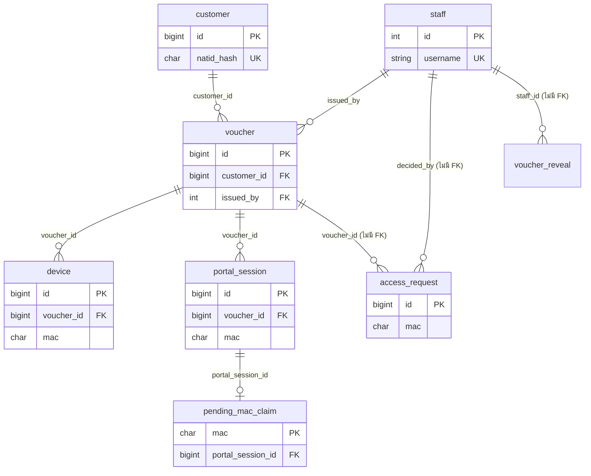

# โครงสร้างฐานข้อมูล (Database Schema)

ระบบใช้ MariaDB 10.6+ / 11.x (charset utf8mb4) สคีมาสุดท้ายหลังใช้ migration ครบ มี **15 ตาราง** ตั้งต้นจาก `sql/001_schema.sql` และปรับด้วย `sql/005` ถึง `sql/013` (ไม่มี `002` และ `004` ในโฟลเดอร์ `sql/`) ตารางที่ไวต่อข้อมูลส่วนบุคคลคือ `customer` และ `access_request` ซึ่งเก็บเลขบัตรประชาชนในรูปแบบ hash + ciphertext + masked เท่านั้น ไม่มี plaintext

ข้อมูลนี้อ้างอิงจากไฟล์ในรีโปเท่านั้น จุดที่ไม่แน่ชัดระบุไว้ในหัวข้อ "ข้อสังเกต" ท้ายเอกสาร

## สารบัญ

1. [ตารางทั้งหมดหลัง migration](#1-ตารางทั้งหมดหลัง-migration)
2. [ความสัมพันธ์ระหว่างตาราง](#2-ความสัมพันธ์ระหว่างตาราง)
3. [ประวัติ migration](#3-ประวัติ-migration)
4. [ตารางไหนใช้โดยโค้ดไหน](#4-ตารางไหนใช้โดยโค้ดไหน)
5. [ข้อมูลอ่อนไหว](#5-ข้อมูลอ่อนไหว)
6. [การเก็บรักษาและการลบข้อมูล (retention)](#6-การเก็บรักษาและการลบข้อมูล-retention)
7. [ข้อสังเกต](#7-ข้อสังเกต)

---

## 1. ตารางทั้งหมดหลัง migration

หมายเหตุ: คอลัมน์ที่มาจาก migration ภายหลังมีป้าย `(0xx)` ระบุไฟล์ต้นทาง ตารางนี้คำนวณจากการไล่ `001` แล้วใช้ `005`-`013` ทับลงไปตามลำดับ (ดูหัวข้อ 3)

### 1.1 `staff` — บัญชีพนักงาน/ผู้ดูแลระบบ

บัญชีพนักงานแต่ละคน (admin/staff) ใช้ล็อกอิน Admin Panel และเป็นผู้ออก voucher/อนุมัติคำขอ

| column | type | null | default / notes |
|---|---|---|---|
| id | INT AUTO_INCREMENT | NO | PK |
| username | VARCHAR(64) | NO | UNIQUE |
| password_hash | VARCHAR(255) | NO | argon2id |
| display_name | VARCHAR(128) | YES | |
| role | ENUM('admin','staff') | NO | 'staff' |
| is_active | BOOLEAN | NO | TRUE |
| must_change_password | BOOLEAN | NO | FALSE (009) |
| password_changed_at | DATETIME | YES | NULL (009) |
| created_at | DATETIME | NO | CURRENT_TIMESTAMP |
| last_login_at | DATETIME | YES | NULL |

- PK: `id`
- Index: UNIQUE(`username`)
- FK: ไม่มี (ตารางอื่นอ้างเข้ามา)
- หมายเหตุ: `totp_secret` ถูกลบด้วย `006_drop_totp.sql` (scaffold 2FA ที่ไม่เคยถูกใช้)

### 1.2 `customer` — ลูกค้า (ผู้ใช้บริการ Wi-Fi)

แถวต่อหนึ่งเลขบัตรประชาชน (ผ่าน hash) ไม่ถูกลบเมื่อ PII ถูกล้าง เพื่อรักษา FK ของ voucher

| column | type | null | default / notes |
|---|---|---|---|
| id | BIGINT AUTO_INCREMENT | NO | PK |
| natid_hash | CHAR(64) | NO | UNIQUE, HMAC-SHA256(natid, NATID_PEPPER) |
| natid_enc | VARBINARY(255) | NO | AES-256-GCM: nonce(12) \|\| ciphertext \|\| tag(16) |
| natid_masked | CHAR(20) | NO | เช่น `1-2345-XXXXX-XX-3` (ข้อมูลล้างแล้ว = `PURGED`) |
| first_seen | DATETIME | NO | CURRENT_TIMESTAMP |
| last_seen | DATETIME | YES | NULL |
| visit_count | INT | NO | 0 |
| is_blocked | BOOLEAN | NO | FALSE |

- PK: `id`
- Index: UNIQUE(`natid_hash`) (ตาม column), INDEX `idx_last_seen`(`last_seen`)
- FK: ไม่มี (ตารางอื่นอ้างเข้ามา)
- ที่มาของค่า: `app/common/crypto.py`, `app/common/customer.py`

### 1.3 `voucher` — ใบ voucher (สิทธิ์ใช้งานช่วงเวลาหนึ่ง)

| column | type | null | default / notes |
|---|---|---|---|
| id | BIGINT AUTO_INCREMENT | NO | PK |
| customer_id | BIGINT | NO | FK → `customer.id` (`fk_voucher_customer`, ON DELETE ไม่ระบุ = RESTRICT) |
| username | VARCHAR(32) | NO | UNIQUE, เช่น `CAFE-8F3K2` |
| password_hash | VARCHAR(255) | NO | argon2id |
| issued_by | INT | NO | FK → `staff.id` (`fk_voucher_staff`) |
| issued_at | DATETIME | NO | CURRENT_TIMESTAMP |
| valid_from | DATETIME | NO | |
| valid_until | DATETIME | NO | |
| quota_mb | INT | YES | NULL = ไม่จำกัด |
| used_mb | INT | NO | 0 |
| max_devices | TINYINT | NO | 2 |
| status | ENUM('active','expired','revoked','used_up') | NO | 'active' |
| auth_sync_needed | BOOLEAN | NO | FALSE (012) |

- PK: `id`
- Index: UNIQUE(`username`), INDEX `idx_status_valid`(`status`, `valid_until`)
- FK: `customer_id` → `customer.id`, `issued_by` → `staff.id`

### 1.4 `device` — อุปกรณ์ (MAC) ที่ผูกกับ voucher

| column | type | null | default / notes |
|---|---|---|---|
| id | BIGINT AUTO_INCREMENT | NO | PK |
| voucher_id | BIGINT | NO | FK → `voucher.id` (`fk_device_voucher`) |
| mac | CHAR(17) | NO | |
| first_seen | DATETIME | NO | CURRENT_TIMESTAMP |
| last_ip | VARCHAR(45) | YES | |

- PK: `id`
- Index: UNIQUE `uq_voucher_mac`(`voucher_id`, `mac`), INDEX `idx_mac`(`mac`)
- FK: `voucher_id` → `voucher.id`

### 1.5 `portal_session` — เซสชันการเข้าใช้งานต่อ MAC

สถานะ `pending` → `authenticated` → `closed` (ค่าเริ่มต้นตาม 001 และ 008)

| column | type | null | default / notes |
|---|---|---|---|
| id | BIGINT AUTO_INCREMENT | NO | PK |
| voucher_id | BIGINT | NO | FK → `voucher.id` (`fk_session_voucher`) |
| mac | CHAR(17) | NO | |
| ip | VARCHAR(45) | NO | |
| hostname | VARCHAR(63) | YES | NULL (011) — ชื่อเครื่องที่ลูกค้าบอกเอง |
| os_label | VARCHAR(64) | YES | NULL (011) |
| started_at | DATETIME | NO | |
| authenticated_at | DATETIME | YES | NULL (001; ใช้ค่านี้จับคู่ log, ดู 008) |
| pending_until | DATETIME | YES | NULL |
| state | ENUM('pending','authenticated','closed') | NO | 'pending' |
| ended_at | DATETIME | YES | NULL |
| bytes_in | BIGINT | NO | 0 |
| bytes_out | BIGINT | NO | 0 |
| terminate_cause | VARCHAR(32) | YES | NULL |

- PK: `id`
- Index: INDEX `idx_time`(`started_at`, `ended_at`), INDEX `idx_mac_time`(`mac`, `started_at`), INDEX `idx_pending`(`state`, `pending_until`)
- FK: `voucher_id` → `voucher.id`
- หมายเหตุ: `001_schema.sql` มีคอลัมน์ `authenticated_at`, `pending_until`, `state`, `idx_pending` อยู่แล้ว การ ADD ใน 008 เป็นการ "ซ่อม" เครื่องที่ติดตั้งจาก 001 ฉบับเก่า (ดู 008 header)

### 1.6 `pending_mac_claim` — กันคำขอ pending ซ้ำของ MAC เดียวกัน

| column | type | null | default / notes |
|---|---|---|---|
| mac | CHAR(17) | NO | PK |
| portal_session_id | BIGINT | YES | UNIQUE, NULL |

- PK: `mac`
- Index: UNIQUE(`portal_session_id`)
- FK: `portal_session_id` → `portal_session.id` (`fk_pending_session`)

### 1.7 `fas_context` — context ที่ gateway ส่งมาให้ FAS (ใช้ครั้งเดียว)

| column | type | null | default / notes |
|---|---|---|---|
| nonce_hash | CHAR(64) | NO | PK, SHA-256 ของ nonce (hex) |
| payload | TEXT | NO | JSON ของ ClientContext |
| request_ip | VARCHAR(45) | NO | |
| expires_at | DATETIME | NO | |
| consumed_at | DATETIME | YES | NULL = ยังไม่ถูกใช้ |

- PK: `nonce_hash`
- Index: INDEX `idx_expiry`(`expires_at`)
- FK: ไม่มี

### 1.8 `voucher_reveal` — โทเคนเปิดดูข้อมูลชั่วคราว (ใช้ครั้งเดียว)

| column | type | null | default / notes |
|---|---|---|---|
| token_hash | CHAR(64) | NO | PK |
| staff_id | INT | NO | (ไม่มี FK) |
| payload | BLOB | NO | รูปแบบการเข้ารหัส ไม่แน่ชัด (ดูหัวข้อ 7) |
| expires_at | DATETIME | NO | |
| consumed_at | DATETIME | YES | NULL |

- PK: `token_hash`
- Index: INDEX `idx_expiry`(`expires_at`)
- FK: ไม่มี
- หมายเหตุ: ไม่พบโค้ดที่ INSERT/SELECT ตารางนี้ในรีโปปัจจุบัน (ดูหัวข้อ 4, 7)

### 1.9 `conn_log` — log การเชื่อมต่อ (metadata จราจร ม.26)

เก็บเฉพาะ metadata ไม่เก็บ payload (D5) partition ได้ถ้าเปิด `sql/003_partitions.sql`

| column | type | null | default / notes |
|---|---|---|---|
| id | BIGINT AUTO_INCREMENT | NO | ส่วนหนึ่งของ PK `(id, ts)` |
| ts | DATETIME(3) | NO | เวลาที่ conntrack ส่ง DESTROY (เวลาจบ connection) |
| started_at | DATETIME(3) | YES | NULL (007) — เวลาเริ่ม connection; ใช้ `COALESCE(started_at, ts)` |
| mac | CHAR(17) | YES | NULL |
| src_ip | VARCHAR(45) | NO | |
| src_port | SMALLINT UNSIGNED | YES | |
| dst_ip | VARCHAR(45) | NO | |
| dst_name | VARCHAR(255) | YES | NULL (015) — ชื่อเว็บที่เครื่องต้นทางถาม DNS ได้ IP นี้ภายใน 1 ชม.ก่อนเริ่ม connection; NULL = ไม่ทราบ (ไม่มีดัชนี) |
| dst_port | SMALLINT UNSIGNED | YES | |
| proto | ENUM('tcp','udp','icmp','other') | NO | 'other' |
| bytes_out | BIGINT | YES | 0 |
| bytes_in | BIGINT | YES | 0 |

- PK: (`id`, `ts`) — ts ต้องอยู่ใน PK เพราะ partition
- Index: INDEX `idx_ts`(`ts`), INDEX `idx_mac_ts`(`mac`, `ts`), INDEX `idx_dst`(`dst_ip`)
- FK: ไม่มี
- Partition: ไม่บังคับ (ดู 003 ด้านล่าง)

### 1.10 `dns_log` — log คำถาม/คำตอบ DNS

| column | type | null | default / notes |
|---|---|---|---|
| id | BIGINT AUTO_INCREMENT | NO | ส่วนหนึ่งของ PK `(id, ts)` |
| ts | DATETIME(3) | NO | |
| client_ip | VARCHAR(45) | YES | NULL — แถว answer ไม่มี client_ip (001 ตั้งเป็น NULL แล้ว; 008 ทำให้เครื่องเก่าเป็นเช่นนั้น) |
| mac | CHAR(17) | YES | |
| qname | VARCHAR(255) | NO | |
| qtype | VARCHAR(10) | YES | |
| answer | VARCHAR(255) | YES | |
| event_kind | ENUM('query','answer') | NO | 'query' (001; 008 ทำให้มีบนเครื่องเก่า) |

- PK: (`id`, `ts`)
- Index: INDEX `idx_ts`(`ts`), INDEX `idx_qname`(`qname`), INDEX `idx_mac_ts`(`mac`, `ts`)
- FK: ไม่มี
- Partition: ไม่บังคับ (ดู 003)

### 1.11 `audit_log` — บันทึกการกระทำของพนักงาน (PDPA)

| column | type | null | default / notes |
|---|---|---|---|
| id | BIGINT AUTO_INCREMENT | NO | PK |
| ts | DATETIME | NO | CURRENT_TIMESTAMP |
| staff_id | INT | YES | NULL (ไม่มี FK จึงคงอยู่แม้ staff ถูกลบ) |
| action | VARCHAR(64) | NO | |
| target | VARCHAR(128) | YES | |
| client_ip | VARCHAR(45) | YES | |
| detail | TEXT | YES | |

- PK: `id`
- Index: INDEX `idx_ts`(`ts`), INDEX `idx_action`(`action`), INDEX `idx_staff`(`staff_id`)
- FK: ไม่มี

### 1.12 `log_manifest` — hash chain รายวันของไฟล์ log

| column | type | null | default / notes |
|---|---|---|---|
| id | BIGINT AUTO_INCREMENT | NO | PK |
| log_date | DATE | NO | |
| filename | VARCHAR(255) | NO | |
| sha256 | CHAR(64) | NO | |
| prev_sha256 | CHAR(64) | YES | NULL |
| size_bytes | BIGINT | NO | |
| sealed_at | DATETIME | NO | CURRENT_TIMESTAMP |
| deletion_state | ENUM('active','pending','deleted') | NO | 'active' (008) |
| deleted_at | DATETIME | YES | NULL (008) |

- PK: `id`
- Index: UNIQUE `uq_date_file`(`log_date`, `filename`)
- FK: ไม่มี

### 1.13 `bypass_alert` — การตรวจพบอุปกรณ์ที่ข้ามระบบ (bypass)

ตั้งใจไม่มี FK เพราะ IP/MAC ที่พบไม่เคย login ผ่านระบบ (005 header)

| column | type | null | default / notes |
|---|---|---|---|
| id | BIGINT AUTO_INCREMENT | NO | PK |
| detected_at | DATETIME | NO | CURRENT_TIMESTAMP |
| ip | VARCHAR(45) | NO | |
| mac | CHAR(17) | NO | |

- PK: `id`
- Index: INDEX `idx_detected_at`(`detected_at`), INDEX `idx_mac`(`mac`)
- FK: ไม่มี (ตั้งใจ)

### 1.14 `access_request` — คำขอใช้งานจากลูกค้า (รอพนักงานอนุมัติ)

| column | type | null | default / notes |
|---|---|---|---|
| id | BIGINT AUTO_INCREMENT | NO | PK |
| code | CHAR(4) | NO | รหัส 4 ตัวที่ลูกค้าแสดงให้พนักงาน |
| mac | CHAR(17) | NO | ยืนยันจาก ARP |
| ip | VARCHAR(45) | NO | |
| hostname | VARCHAR(63) | YES | NULL (011) |
| os_label | VARCHAR(64) | YES | NULL (011) |
| user_agent | VARCHAR(255) | YES | NULL (011) |
| natid_hash | CHAR(64) | YES | NULL = ล้างแล้วหลังตัดสินใจ |
| natid_enc | VARBINARY(255) | YES | NULL = ล้างแล้วหลังตัดสินใจ |
| natid_masked | CHAR(20) | NO | คงไว้เป็นร่องรอย |
| consent_at | DATETIME | NO | |
| status | ENUM('pending','approved','rejected','expired') | NO | 'pending' |
| created_at | DATETIME | NO | CURRENT_TIMESTAMP |
| expires_at | DATETIME | NO | |
| decided_at | DATETIME | YES | NULL |
| decided_by | INT | YES | NULL (ไม่มี FK) |
| decision_note | VARCHAR(255) | YES | NULL |
| voucher_id | BIGINT | YES | NULL (ไม่มี FK) |
| portal_session_id | BIGINT | YES | NULL (ไม่มี FK) |
| auth_sent_at | DATETIME | YES | NULL — cafe-reconcile สั่ง `ndsctl auth` แล้ว |

- PK: `id`
- Index: INDEX `idx_status`(`status`, `expires_at`), INDEX `idx_mac`(`mac`, `created_at`)
- FK: ไม่มีที่ประกาศในสคีมา (`decided_by`, `voucher_id`, `portal_session_id` เป็นคอลัมน์ธรรมดา)

### 1.15 `rate_attempt` — ตัวนับความพยายามที่ล้มเหลว (rate limit)

| column | type | null | default / notes |
|---|---|---|---|
| id | BIGINT AUTO_INCREMENT | NO | PK |
| bucket | VARCHAR(128) | NO | เช่น `login:<ip>`, `register:<mac>` (ไม่มีรหัสผ่านหรือเลขบัตร) |
| ts | DATETIME | NO | CURRENT_TIMESTAMP |

- PK: `id`
- Index: INDEX `idx_bucket_ts`(`bucket`, `ts`), INDEX `idx_ts`(`ts`)
- FK: ไม่มี

---

## 2. ความสัมพันธ์ระหว่างตาราง

ตารางต่อไปนี้ไม่มีความสัมพันธ์ FK กับตารางอื่น และเชื่อมกันผ่านค่า `mac` / `ip` / `ts` เท่านั้น: `conn_log`, `dns_log`, `audit_log`, `log_manifest`, `bypass_alert`, `fas_context`, `voucher_reveal`, `rate_attempt`

---

## 3. ประวัติ migration

| ไฟล์ | สิ่งที่เปลี่ยน |
|---|---|
| `001_schema.sql` | สร้างตารางตั้งต้น 12 ตาราง (staff, customer, voucher, device, portal_session, pending_mac_claim, fas_context, voucher_reveal, conn_log, dns_log, audit_log, log_manifest) ใช้ `CREATE TABLE IF NOT EXISTS`; ฉบับปัจจุบันมีคอลัมน์และตาราง R2 ครบแล้ว |
| `002` | ไม่มีไฟล์ในโฟลเดอร์ `sql/` และไม่มีการอ้างถึงใน `install.sh` หรือโค้ด (ไม่แน่ชัดว่าเคยมีหรือเป็นเลขที่ข้าม) |
| `003_partitions.sql` | (optional, เปิดด้วย `install.sh --enable-partitions`) แบ่ง `conn_log`/`dns_log` เป็น RANGE partition ตาม `TO_DAYS(ts)` สร้าง stored procedure และ EVENT รายวัน สำหรับ `DROP PARTITION` ตามอายุ |
| `004` | ไม่มีไฟล์ในโฟลเดอร์ `sql/` และไม่มีการอ้างถึง (ไม่แน่ชัด) |
| `005_bypass_alert.sql` | สร้างตาราง `bypass_alert` |
| `006_drop_totp.sql` | ลบคอลัมน์ `staff.totp_secret` |
| `007_conn_log_started_at.sql` | เพิ่ม `conn_log.started_at DATETIME(3) NULL` |
| `008_pending_sessions_and_log_columns.sql` | ซ่อมเครื่องเก่าให้เท่ากับ 001: เพิ่ม `portal_session.authenticated_at/pending_until/state` + index + backfill ข้อมูลเก่า, สร้าง `pending_mac_claim`/`fas_context`/`voucher_reveal` ถ้ายังไม่มี, `conn_log.mac` เป็น NULL ได้, `dns_log.client_ip` เป็น NULL ได้ + เพิ่ม `event_kind`, `log_manifest.deletion_state/deleted_at` |
| `009_staff_password_lifecycle.sql` | เพิ่ม `staff.must_change_password` และ `staff.password_changed_at` |
| `010_access_request.sql` | สร้างตาราง `access_request` (คำขอใช้งานจากลูกค้า) |
| `011_device_info.sql` | เพิ่ม `hostname`, `os_label`, `user_agent` ใน `access_request`; `hostname`, `os_label` ใน `portal_session` |
| `012_voucher_extend.sql` | เพิ่ม `voucher.auth_sync_needed` (ธงให้ cafe-reconcile deauth/auth ใหม่หลังต่อเวลา) |
| `013_rate_attempt.sql` | สร้างตาราง `rate_attempt` |
| `014_dns_qname_rev.sql` | เพิ่ม `dns_log.qname_rev` (= `REVERSE(qname)`) + ดัชนี ให้ค้นโดเมนแบบ "ตรงพอดีหรือซับโดเมน" ใช้ดัชนีได้ (`common/domain_match.py`) |
| `015_conn_dst_name.sql` | เพิ่ม `conn_log.dst_name VARCHAR(255) NULL` (คอลัมน์เดียว ไม่มีดัชนี; `conn_collector` เติมตอนเขียน) |

ลำดับที่ `install.sh` รันจริง (บรรทัด ~931-1040): 001, 005, 006, 007, 008, 009, 010, 013, 012, 011 และ 003 เฉพาะเมื่อกำหนด `--enable-partitions` ไฟล์ 012 กับ 013 ไม่พึ่งกันจึงสลับลำดับได้โดยไม่กระทบ

---

## 4. ตารางไหนใช้โดยโค้ดไหน

ผลจากการค้นชื่อตารางใน `app/` และ `tools/` (เฉพาะไฟล์หลัก; `R` = อ่าน, `W` = เขียน/แก้ไข/ลบ)

| ตาราง | โค้ดหลัก (R/W) |
|---|---|
| `staff` | `app/admin/app.py` (ล็อกอิน R, อัปเดต last_login_at W, ตั้ง/เปลี่ยนรหัส W), `app/admin/views/staff.py` (CRUD W/R), `app/setup/app.py` (สร้าง admin แรก W), `app/setup/restore.py` (W), `tools/reset_admin.py` (W), `app/admin/views/access.py`, `overview.py` (R join) |
| `customer` | `app/common/customer.py` (anonymize W, retention hold R), `app/admin/views/access.py` (INSERT/UPDATE W), `app/admin/views/customers.py` (ค้นด้วย hash R, บล็อก W, เปิดเลขบัตร R), `app/fas/app.py` (เช็ค is_blocked R), `tools/purge_old_data.py` (R/W ผ่าน anonymize), `tools/export_evidence.py` (R), `app/setup/restore.py` (ตรวจ hash หลังกู้คืน R) |
| `voucher` | `app/admin/views/access.py` (INSERT W, ต่อเวลา/ตั้ง max_devices/เพิกถอน W), `app/common/access.py` (R), `app/fas/app.py` (R), `tools/enforce_voucher_expiry.py` (expired/used_up/used_mb W), `tools/reconcile_pending.py` (auth_sync_needed W), `tools/lab_issue_voucher.py` (ออก voucher สำหรับทดสอบ; ไม่ได้ตรวจรายบรรทัด), `tools/export_evidence.py` (R), `app/admin/views/overview.py` (R) |
| `device` | `app/common/access.py` (R/W), `app/fas/app.py` (R/W), `app/admin/views/access.py` (R), `tools/reconcile_pending.py` (INSERT ... ON DUPLICATE KEY W) |
| `portal_session` | `app/common/access.py` (INSERT W), `app/fas/app.py` (สถานะ/bytes W), `app/common/health.py`, `app/common/customer.py`, `app/common/log_mapping.py` (R), `app/admin/views/logs.py`, `overview.py` (R), `app/logger/conn_collector.py` (R), `tools/reconcile_pending.py` (promote/expire W), `tools/enforce_voucher_expiry.py` (R/W), `tools/export_evidence.py` (R) |
| `pending_mac_claim` | `app/common/access.py` (W), `tools/reconcile_pending.py` (DELETE W) |
| `fas_context` | `app/fas/app.py` (INSERT W, SELECT R, `consumed_at` W), `tools/reconcile_pending.py` (DELETE หมดอายุ W) |
| `voucher_reveal` | ไม่พบการ INSERT/SELECT ในโค้ดปัจจุบัน; `tools/purge_old_data.py` (DELETE หมดอายุ W) |
| `conn_log` | `app/logger/conn_collector.py` (INSERT W), `app/logger/bypass_detector.py` (R), `app/common/traffic.py` (R), `app/common/customer.py` (JOIN กับ portal_session R), `app/common/log_mapping.py` (R), `app/common/health.py` (R), `app/admin/views/logs.py`, `overview.py` (R), `tools/enforce_voucher_expiry.py` (รวม bytes R), `tools/export_evidence.py` (R), `tools/check_disk.py` (R), `tools/purge_old_data.py` (DELETE W) |
| `dns_log` | `app/logger/dns_collector.py` (INSERT W), `app/logger/bypass_detector.py` (R), `app/common/log_mapping.py`, `app/common/customer.py`, `app/common/health.py` (R), `app/admin/views/logs.py` (R), `tools/export_evidence.py` (R), `tools/check_disk.py` (R), `tools/purge_old_data.py` (DELETE W) |
| `audit_log` | `app/common/audit.py` (INSERT W, ใช้ร่วมกันทั้งระบบ), `app/admin/views/customers.py`, `keys.py`, `staff.py` (เรียกผ่าน audit W), `app/fas/app.py`, `app/logger/*` (เรียกผ่าน audit W), `app/setup/restore.py` (INSERT W), `tools/export_evidence.py` (R), `tools/purge_old_data.py` (เขียนสรุปการลบ W) |
| `log_manifest` | `app/logger/integrity.py` (INSERT/UPDATE/SELECT W/R), `app/common/health.py` (R) |
| `bypass_alert` | `app/logger/bypass_detector.py` (SELECT กันซ้ำ R, INSERT W) |
| `access_request` | `app/fas/app.py` (INSERT W, สถานะ R), `app/admin/views/access.py` (R, อนุมัติ/ปฏิเสธ W), `app/admin/app.py`, `app/admin/views/overview.py` (R), `app/common/access.py` (R), `app/common/customer.py` (ล้าง hostname/user_agent W), `tools/reconcile_pending.py` (expire W, auth_sent_at W), `tools/purge_old_data.py` (DELETE W) |
| `rate_attempt` | `app/common/ratelimit.py` (INSERT/SELECT/DELETE W/R), `tools/purge_old_data.py` (DELETE W) |

---

## 5. ข้อมูลอ่อนไหว

เลขบัตรประชาชนไม่เก็บเป็น plaintext (หลักการ D6 ใน `app/common/crypto.py`) เก็บ 3 รูปแบบ:

| คอลัมน์ | รูปแบบ | หมายเหตุ |
|---|---|---|
| `customer.natid_hash`, `access_request.natid_hash` | **hash** HMAC-SHA256 (hex 64 ตัว) ด้วยค่า pepper `NATID_PEPPER` | deterministic ใช้ค้น/กันซ้ำ (`crypto.natid_hash`); ไม่ย้อนกลับได้โดยไม่มี pepper |
| `customer.natid_enc`, `access_request.natid_enc` | **ciphertext** AES-256-GCM ด้วยกุญแจ `NATID_DEK` รูปแบบ nonce(12)\|\|ct\|\|tag(16) | ถอดรหัสได้ด้วย `crypto.natid_decrypt` ใช้ที่ `app/admin/views/customers.py` (reveal) และ `app/admin/views/access.py` (อนุมัติ) |
| `customer.natid_masked`, `access_request.natid_masked` | **masked** เช่น `1-2345-XXXXX-XX-3` | แสดงผลบนจอ ไม่ใช่ ciphertext |

พฤติกรรมการล้าง:
- เมื่ออนุมัติ/ปฏิเสธ/หมดเวลาคำขอ ระบบตั้ง `natid_hash = NULL, natid_enc = NULL` ใน `access_request` (`app/admin/views/access.py` บรรทัด ~146 และ ~238; `tools/reconcile_pending.py` บรรทัด ~75) เหลือเฉพาะ `natid_masked`
- เมื่อล้างข้อมูลลูกค้า (`anonymize_customer`, `app/common/customer.py`) ตั้ง `natid_hash = 'PURGED-<id>'`, `natid_enc = ''`, `natid_masked = 'PURGED'` และล้าง `portal_session.hostname`, `access_request.hostname`, `access_request.user_agent` ของ voucher ที่ผูกกับลูกค้านั้น
- การถอดรหัสต้องเขียน `audit_log` ทุกครั้ง (ตาม docstring ของ `crypto.natid_decrypt`)

คอลัมน์อื่นที่ควรระวัง:

| คอลัมน์ | ประเภท | หมายเหตุ |
|---|---|---|
| `staff.password_hash`, `voucher.password_hash` | hash argon2id | ไม่เก็บรหัสเป็น plaintext |
| `fas_context.nonce_hash` | SHA-256 ของ nonce | `payload` เป็น JSON ของ context ของ client |
| `voucher_reveal.payload` | BLOB | รูปแบบการเข้ารหัสไม่แน่ชัด (ไม่พบผู้เขียนในโค้ด) |
| `portal_session.hostname`, `os_label`; `access_request.hostname`, `os_label`, `user_agent` | ข้อความที่เครื่องลูกค้าส่งเอง | ปลอมได้ ใช้ประกอบเท่านั้น; `hostname` อาจเป็นชื่อจริง จึงถูกล้างตอน anonymize |
| `conn_log.mac`, `src_ip`, `dst_ip`, `ports`; `dns_log.qname`, `client_ip` | metadata จราจร | ไม่มี payload (D5) แต่เป็นข้อมูลที่ ม.26 บังคับให้เก็บ |
| `audit_log.detail` | TEXT อิสระ | ไม่แน่ชัดว่ามีข้อมูลส่วนบุคคลในบางกรณีหรือไม่ |

---

## 6. การเก็บรักษาและการลบข้อมูล (retention)

ตัวลบหลักคือ `tools/purge_old_data.py` รันทุกวันจาก `cafe-maintenance.timer` (ตาม header ของไฟล์) ค่าอายุจาก `LOG_RETENTION_DAYS` (ค่า default ในโค้ด 180 วัน; ถ้าต่ำกว่า 90 วันจะปฏิเสธทำงาน) และ `CUSTOMER_RETENTION_DAYS`

| ตาราง | วิธีจัดการ | จากไหน |
|---|---|---|
| `conn_log` | `DELETE WHERE ts < cutoff` | `purge_old_data.py` (`purge_conn_and_dns_logs`) |
| `dns_log` | `DELETE WHERE ts < cutoff` | `purge_old_data.py` |
| `conn_log`, `dns_log` (ถ้าเปิด 003) | `ALTER TABLE ... DROP PARTITION` ตามอายุ (ทั้งก้อน) | `003_partitions.sql` ผ่าน EVENT รายวัน; `install.sh` ผูกค่าให้ตรงกับ `LOG_RETENTION_DAYS` |
| `customer` | **ล้าง PII ไม่ลบแถว** (`natid_*` ตามหัวข้อ 5) เฉพาะที่ `last_seen` เก่ากว่า `CUSTOMER_RETENTION_DAYS`, ไม่มี voucher active/ยังไม่หมดอายุ, และไม่อยู่ในช่วง retention hold | `purge_old_data.py::purge_stale_customers` → `common/customer.py::anonymize_customer` (ใช้ร่วมกับ DSR `POST /customers/<id>/erase`) |
| `access_request` | `DELETE WHERE created_at < log cutoff` | `purge_old_data.py` |
| `voucher_reveal` | `DELETE WHERE expires_at < NOW()` | `purge_old_data.py` |
| `rate_attempt` | `DELETE WHERE ts < NOW() - 1 day` | `purge_old_data.py` (และ `common/ratelimit.py` ลบแถวของ bucket เดิมเอง) |
| `fas_context` | `DELETE WHERE expires_at < NOW() - 1 day` | `tools/reconcile_pending.py` (ไม่ใช่ purge) |
| `pending_mac_claim` | `DELETE` แถวที่ `portal_session_id IS NULL` หรือเมื่อคำขอจบ | `tools/reconcile_pending.py` |
| `log_manifest` | สถานะ `pending`/`deleted` สำหรับ archive ไฟล์ log | `app/logger/integrity.py` (prune_archives) — ไม่ใช่ purge |

ไม่ถูกลบอัตโนมัติ:
- `audit_log`, `log_manifest`: ตาม docstring ของ `purge_old_data.py` เป็นหลักฐานตรวจสอบ ต้องลบด้วยมือถ้าจำเป็น
- `staff`, `voucher`, `device`, `portal_session`: ไม่พบคำสั่ง DELETE ในโค้ด (ดูข้อสังเกต)
- `bypass_alert`: ไม่พบคำสั่ง DELETE ในโค้ด (ไม่แน่ชัดว่าเป็นการตั้งใจ)

---

## 7. ข้อสังเกต

1. **ไม่มี `002` และ `004`** ในโฟลเดอร์ `sql/` และไม่มีการอ้างถึงที่ไหนในรีโป (รวม `install.sh`) ไม่แน่ชัดว่าเป็นเลขที่ข้ามหรือเคยมีแล้วถูกรวม
2. **`001_schema.sql` เป็นสคีมาสำหรับติดตั้งใหม่ฉบับเต็ม** (มีคอลัมน์และตารางของ R2 แล้ว) ส่วน `008` ถึง `013` เป็น migration สำหรับเครื่องที่ติดตั้งจาก 001 ฉบับเก่า ทั้งสองทางต้องให้ผลเท่ากัน ซึ่ง 008 ระบุไว้ในคอมเมนต์ว่าตั้งใจเป็นเช่นนั้น
3. **คอมเมนต์ใน `003_partitions.sql` บอกว่า partition "รายสัปดาห์" แต่โค้ดสร้าง partition รายวัน**: `cafewifi_ensure_future_partition` ใช้ `CURDATE() + 14 วัน` เป็นขอบ และตั้งชื่อ `p<YYYYMMDD>` ทุกวัน จึงได้ partition ละ 1 วัน
4. **EVENT ใน `003` ฝัง `180` ไว้ตายตัว** (`cafewifi_partition_maintenance(180)`) ถ้าไม่ได้รัน `install.sh --enable-partitions` จะไม่ตรงกับ `LOG_RETENTION_DAYS` ที่ตั้งไว้
5. **`voucher_reveal` ไม่มีผู้เขียนในโค้ดปัจจุบัน** พบเฉพาะการ DELETE ใน `purge_old_data.py` และการอ้างใน tests (`tests/test_purge_and_export.py`, `tests/test_admin_issue_and_moderation.py`, `tests/test_quota_and_2fa_removal.py`) ไม่แน่ชัดว่าเป็นของค้างจาก R2 หรือยังไม่ได้เดินสาย
6. **`bypass_alert` ไม่มีการลบข้อมูลเลย** และ `portal_session`, `device`, `voucher` ก็ไม่ถูกลบเช่นกัน (เป็น metadata ที่ยังอยู่หลัง anonymize) ไม่แน่ชัดว่าเป็นการตัดสินใจโดยตั้งใจหรือยังไม่มี policy รองรับ
7. **FK ที่ขาดหาย**: `access_request.decided_by`, `access_request.voucher_id`, `access_request.portal_session_id`, `voucher_reveal.staff_id` เป็นคอลัมน์ธรรมดาไม่มี FK
8. **คอลัมน์ที่โค้ดอ้างถึงแต่ไม่พบในสคีมา**: ไม่พบ เมื่อไล่ alias ของตารางจาก `ps.`, `v.`, `c.`, `ar.`, `cl.`, `dl.` และคำสั่ง INSERT ทั้งหมดแล้วทุกคอลัมน์มีอยู่ในสคีมาที่ประกอบจาก 001 + migration (สิ่งที่พบเป็น alias ของ object อื่น เช่น `cl.network` ใน `app/setup/netinfo.py` เป็นของ `ipaddress` ไม่ใช่ตาราง)
9. **`customer.natid_enc` เป็น `NOT NULL` แต่ตอนล้างข้อมูลตั้งเป็นสตริงว่าง** ใช้งานได้เพราะ `natid_decrypt` ตรวจความยาวและ `customers.py` จัดการกรณีนี้ไว้แล้ว (คอมเมนต์ N6)
